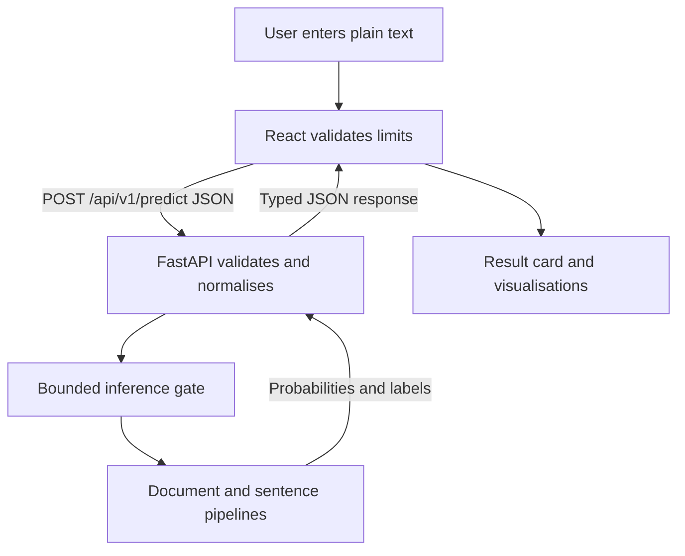

# AI-Generated Content Detection

COS30049 Assignment 3 secure full-stack application. The application helps students and educators inspect whether text resembles the AI-generated writing learned by our Assignment 2 classifiers. It is an indicator, not proof of authorship or academic misconduct.

## What is submitted

- React and Vite single-page interface with input validation, visible loading/success/error states, a 404 page and an unexpected-error fallback.
- Two interactive result views: filterable sentence likelihood highlighting and selectable session comparison bars.
- FastAPI API connected to the trained Assignment 2 sentence and document pipelines.
- Advanced application-level denial-of-service protection and a controlled before/after load experiment.
- Repeated detection-evasion attack and defensive Unicode normalisation experiment.
- Intermediate configuration and dependency protection with reproducible audit evidence.

## Architecture and request flow


The same architecture is also provided as a static diagram for renderers that do not display Mermaid:


A real request follows this path:

1. `frontend/src/components/AI-Detection.jsx` checks the same character, byte and sentence limits as the API.
2. `frontend/src/components/detectAPI.jsx` sends `{ "text": "..." }` to `POST /api/v1/predict` and translates the shared error object into a readable message.
3. `backend/app/main.py` rejects unsupported content types and excessive request bodies before JSON parsing. Pydantic validates the request shape.
4. `backend/app/validation.py` enforces content limits. `backend/app/normalisation.py` creates a security-normalised inference copy while preserving the submitted text for display.
5. `backend/app/security.py` bounds concurrent model work and runs it outside the async event loop. `backend/app/model_service.py` applies the same Assignment 2 feature functions used during training.
6. The document pipeline returns the overall AI probability. The sentence pipeline is applied to each sentence and returns sentence probabilities.
7. Pydantic validates the response before React renders the result. All expected and unexpected API errors use the same safe JSON structure from `backend/app/errors.py`.

Both fitted pipelines load once in the FastAPI lifespan. Missing or incompatible models stop startup rather than serving fabricated results.

## Repository map

```text
backend/                    FastAPI service, tests and security experiments
  app/                      Routes, models, validation, normalisation and controls
  experiments/data/         Fixed local security test data
  experiments/results/      CSV rows and JSON summaries from actual runs
  tests/                    API, overload, failure and normalisation tests
frontend/                   React/Vite interface and component/API tests
artifacts/                  Fitted sentence and document Joblib pipelines
classification/             Assignment 2 features, training and prediction code
clustering/                 Assignment 2 clustering work
visualisation/              Assignment 2 analysis work
security-evidence/          Dependency audit record and interpretation
```

## Clean Windows PowerShell setup

Required versions: Python 3.12 and Node.js 22 or newer. All application dependency versions are pinned. From the repository root:

```powershell
py -3.12 -m venv .venv
Set-ExecutionPolicy -Scope Process -ExecutionPolicy RemoteSigned
& ".\.venv\Scripts\Activate.ps1"
python -m pip install --upgrade pip
python -m pip install -r backend\requirements-dev.txt
Copy-Item backend\.env.example .env

Set-Location frontend
npm ci
Copy-Item .env.example .env
Set-Location ..
```

The production-only backend dependencies are in `backend/requirements.txt`. `backend/requirements-dev.txt` adds the experiment and test clients. The root `requirements.txt` additionally installs the Assignment 2 plotting packages.

### Run the application

Open two PowerShell terminals from the repository root and activate the same Python environment in the backend terminal.

Backend:

```powershell
& ".\.venv\Scripts\Activate.ps1"
python -m uvicorn backend.app.main:app --host 127.0.0.1 --port 8000
```

Frontend:

```powershell
Set-Location frontend
npm run dev -- --host 127.0.0.1
```

Open `http://127.0.0.1:5173`. Interactive API documentation is at `http://127.0.0.1:8000/docs` and the OpenAPI JSON is at `/openapi.json`.

The default origins are exactly `http://localhost:5173` and `http://127.0.0.1:5173`. For another frontend origin, update both `.env` files; do not use a wildcard.

## API contract

| Method | Endpoint | Genuine purpose | Success |
| --- | --- | --- | --- |
| `POST` | `/api/v1/predict` | Validate, normalise and classify text | `200` |
| `GET` | `/api/v1/health` | Lightweight readiness check that does not wait for inference | `200` |
| `GET` | `/api/v1/model-info` | Public model names, limits and normalisation steps | `200` |

Request:

```json
{
  "text": "Furthermore, this explanation demonstrates how structured writing can be analysed."
}
```

Response fields are identical for Human and AI results:

```json
{
  "prediction": "ai",
  "ai_probability": 0.91,
  "confidence": 0.91,
  "confidence_range": {
    "lower": 0.84,
    "upper": 0.96,
    "method": "95% bootstrap interval across sentence AI probabilities"
  },
  "sentence_results": [
    {
      "text": "Example sentence.",
      "label": "ai",
      "ai_probability": 0.93
    }
  ],
  "normalisation_applied": false
}
```

- `ai_probability` is the calibrated probability of class `1` (AI), including when the returned label is `human`.
- `confidence` is the probability assigned to the returned class.
- `confidence_range` is `null` for a single sentence. For multiple sentences it describes variation across sentence scores, not guaranteed real-world accuracy.
- Sentence results use the sentence model on each sentence because the overall document model produces only one document score.
- `normalisation_applied` tells the interface that the model received a defended copy. The original characters remain available for safe text-node display.

Every error has one structure:

```json
{
  "error": {
    "code": "TEXT_TOO_LARGE",
    "message": "Text must not exceed 10,000 characters."
  }
}
```

The API uses `400` for unsafe/empty content, `413` for size or sentence limits, `415` for a non-JSON prediction request, `422` for malformed JSON or shape errors, `429` for the additional rate limit, `503` for bounded-capacity rejection/timeouts and `500` for unexpected failures. Stack traces, model paths and exception details are never returned.

### Input limits

| Limit | Default | Why |
| --- | ---: | --- |
| Minimum text | 20 characters | Avoid meaningless model input |
| Maximum text | 10,000 characters | Bound feature extraction and inference work |
| UTF-8 body text | 40,000 bytes | Bound multi-byte input before inference |
| Sentence count | 100 | Bound repeated sentence-model calls |
| Concurrent inference | 2 | Preserve service capacity |
| Queue wait | 0.05 seconds | Reject overload promptly with `503` |
| Inference timeout | 15 seconds | Bound the caller's wait |

## Model integration

The committed models are:

- `artifacts/classification/final_text_classifier.joblib` — sentence classifier.
- `artifacts/document_classification/final_text_classifier.joblib` — document classifier.

`classification/features.py` is shared by training and runtime, so TF-IDF and the engineered numeric feature frame match the fitted pipelines. Both artifacts expose `predict_proba`; the API refuses startup if calibrated probabilities are unavailable. It never converts a raw SVM decision score into a probability.

The application does not retrain on startup. To reproduce Assignment 2 training when the uncommitted source datasets are available:

```powershell
python -m classification.train --dataset data\processed\final_dataset.csv
python -m classification.train --unit document --dataset data\processed\para_dataset.csv
```

The large source CSVs are intentionally excluded from Git. They are not required to run the submitted application because the fitted artifacts are committed.

## Threat model

### Who may attack it?

An evasion attacker may want AI text labelled Human. A disruptive user or bot may try to occupy model capacity. A scanner may probe unsafe defaults, exposed errors or vulnerable dependencies. They can bypass React and send arbitrary HTTP requests directly to FastAPI.

### What do they want?

- Change tokenisation while leaving text visually similar, lowering the AI score.
- Exhaust CPU/inference capacity so legitimate requests and health checks stall.
- Learn internal paths or implementation details from failures.
- Exploit permissive origins, missing browser protections or vulnerable packages.

### What can they actually reach?

They can control one bounded plain-text JSON field, request timing/concurrency, headers and origin. There are no accounts, database queries, file uploads, user-selected URLs, HTML interpretation or command execution. Therefore denial of service, detection evasion, misconfiguration and dependency risk apply. SQL injection, broken access control, unsafe upload, SSRF and command injection are not exposed by this design.

The React application renders submitted content through React text nodes and never uses `dangerouslySetInnerHTML`.

## Section 2.7 defences nominated for marking

### 1. Advanced denial-of-service protection

Before inference, the API bounds JSON body size, characters, UTF-8 bytes and sentence count using linear-time processing. Inference runs in worker threads rather than the async event loop. A semaphore allows two model calls and a 50 ms bounded queue; excess work receives `503`. The independent health route does no inference and stays responsive. A high per-client sliding-window rate limit is only an extra safeguard, not the nominated mechanism.

The local experiment uses the real HTTP endpoint and a controlled 250 ms experiment-only model delay. Production configuration cannot disable the protection or add a delay unless explicit local experiment mode is enabled.

```powershell
python -m backend.experiments.dos_experiment --requests 20
```

Actual committed run on 5 November 2026:

| Measurement | Baseline | Protected |
| --- | ---: | ---: |
| Total concurrent requests | 20 | 20 |
| HTTP `200` | 20 | 2 |
| HTTP `503` | 0 | 18 |
| Mean response time | 973.87 ms | 124.53 ms |
| Median response time | 867.15 ms | 80.66 ms |
| Maximum response time | 1265.67 ms | 453.37 ms |
| Health during load | `200`, 48.75 ms | `200`, 38.71 ms |

This demonstrates application-level overload control on one machine, not protection against a network-level distributed attack. A timed-out Python worker cannot be forcibly killed; input bounds and the semaphore prevent unbounded accumulation.

### 2. Intermediate secure configuration and dependency management

- `debug=False`; unexpected exceptions are logged server-side and returned as a generic shared error.
- Exact CORS origins come from environment settings; startup rejects `*`.
- A placeholder-only `.env.example` is committed and local `.env` files are ignored.
- CSP, frame, MIME-sniffing, referrer, permissions and HSTS headers are added to normal and early-error responses.
- Direct malicious-request tests cover untrusted CORS preflight, oversized bodies, bad content type and error leakage.
- Python and npm versions are exact. Tests run after dependency changes.

Actual dependency audit before remediation found 10 Python advisory entries in Starlette 0.49.3 and 6 npm vulnerable packages (1 critical, 5 moderate). FastAPI/Starlette and the affected frontend development tools were changed to compatible fixed versions. Re-running both audits found zero known vulnerabilities. Commands and the exact interpretation are in `security-evidence/README.md`.

#### OWASP ZAP dynamic scan

The team scanned both locally running application surfaces with OWASP ZAP Dev Standard in isolated sessions. The earlier scans established the before state; the final rescans measured the submitted header and resource-integrity configuration.

**Final backend rescan — `http://127.0.0.1:8000/docs`:**

| Risk | Final finding | Interpretation |
| --- | --- | --- |
| High | None | No high-risk alert reported |
| Medium | CSP `style-src unsafe-inline` | Swagger UI requires runtime presentation styles; inline JavaScript remains blocked |
| Low | None | The previous cross-domain JavaScript warning was eliminated after SRI hardening |
| Informational | Modern Web Application | Technology classification, not an exploit |

Final backend counts were **0 high, 1 medium, 0 low and 1 informational**. Compared with the earlier scan, the documentation now has a restrictive CSP, same-origin initialiser, exact Swagger version pinning, and verified SHA-384 integrity metadata with anonymous CORS mode. Both missing-SRI findings and the cross-domain JavaScript warning disappeared. Normal JSON API responses retain the stricter `default-src 'none'` policy.

**Final frontend rescan — compiled preview at `http://localhost:5173`:**

| Risk | Final finding | Instances | Interpretation |
| --- | --- | ---: | --- |
| High | None | 0 | No high-risk alert reported |
| Medium | CSP `style-src unsafe-inline` | 3 | Material UI runtime styling compatibility; scripts remain restricted |
| Low | Timestamp Disclosure — Unix | 1 category | Low-confidence match of a fixed 2018 value in bundled dependency code, not user or server data |
| Informational | Suspicious Comments | 1 category | False-positive match of `select` inside minified selector-processing code |
| Informational | Modern Web Application | 3 | Technology classification, not an exploit |

Final frontend counts were **0 high, 1 medium, 1 low and 2 informational**. The final scan no longer reported missing CSP, anti-clickjacking, SRI or `X-Content-Type-Options`. The compiled preview sends CSP, frame, MIME-sniffing, referrer and permissions protections. External Google Fonts were removed, eliminating their integrity warning.

The remaining inline-style allowances are documented compatibility costs limited to presentation styling; neither policy permits unrestricted inline JavaScript. Passive low/informational matches were inspected rather than automatically dismissed. ZAP results are interpreted together with dependency audits, malicious-request tests and the reproducible security experiments. Exact counts and limitations are recorded under `security-evidence/`.

## Section 2.8 detection evasion

```powershell
python -m backend.experiments.detection_evasion
```

The fixed, original test set contains 12 AI examples correctly detected before attack. Four meaning-preserving variants are made per eligible example: look-alike Cyrillic/Greek characters, zero-width characters, compatibility characters and unusual whitespace. The same 48 variants are measured first without defence and then with the submitted normaliser.

The defence applies Unicode NFKC, removes zero-width/unsafe control characters, normalises unusual whitespace, and maps only a documented set of Latin-looking confusables. It passes only the copy to the model and preserves the original text for display.

| Measurement | Result |
| --- | ---: |
| Fixed AI examples | 12 |
| Eligible correctly detected AI examples | 12 |
| Attacked variants | 48 |
| Evasion success before defence | 47.92% |
| Evasion success after defence | 0.00% |
| Average confidence change before defence | -0.4680 |
| Average confidence change after defence | 0.0000 |
| Clean controls | 8 |
| Clean control labels changed | 0 (0%) |
| Remaining evasions in this fixed set | 0 |

These figures are evidence for this small fixed security set, not general model accuracy. The limited map cannot cover every Unicode confusable. A larger map may reduce more attacks but risks corrupting legitimate multilingual writing. The before/after CSV and JSON summary are committed under `backend/experiments/results/`.

## Tests and verification

From the repository root with the environment active:

```powershell
python -m pytest -q
python -m compileall -q backend\app backend\experiments

Set-Location frontend
npm run test:run
npm run lint
npm run build
npm audit
Set-Location ..

python -m pip_audit -r backend\requirements.txt
```

Final verified results:

- Backend: 20 tests passed (one upstream TestClient deprecation warning).
- Frontend: 10 tests passed across 4 files.
- ESLint: passed with no errors.
- Vite production build: passed (one non-blocking 500 kB chunk-size warning).
- `npm audit`: 0 vulnerabilities.
- `pip-audit`: no known vulnerabilities.

Tests cover endpoints, Human/AI schemas, malformed and malicious input, safe failures, startup failure, Unicode normalisation, concurrent inference, overload `503`, responsive health checks, evasion calculations, frontend validation, API errors, loading/results, visualisation interaction and fallback pages.

## Frontend configuration

`frontend/.env.example` contains the only frontend setting:

```text
VITE_API_BASE_URL=http://127.0.0.1:8000
```

Person 2 can change that base URL for deployment while keeping the `/api/v1` routes unchanged. The backend origin list must be updated to the exact deployed frontend origin.

## Known limitations and next steps

- AI detection can produce false positives and false negatives; users should treat the score as supporting information only.
- The fixed evasion corpus is intentionally small and the confusable mapping trades attack coverage against multilingual integrity.
- Sentence display uses the same pipeline per sentence; it is not a separate explanation model.
- Session history exists only in browser memory and disappears on refresh. Text is not sent to a database or stored by the server.
- The Vite bundle is approximately 537 kB minified because Material UI is bundled together. Route/component code splitting is a future performance improvement.
- Before public deployment, terminate TLS at a production proxy, set the exact production origins, add infrastructure-level request/body limits and repeat the security scans in that environment.

## Generative AI use statement

Generative AI tools were used for brainstorming, code review, debugging suggestions and documentation editing. Team members inspected, adapted, tested and take responsibility for every submitted change and result. No model result, experiment measurement, test result or source was invented. This statement should be updated with any additional use required by the unit's declaration process before final submission.

## References

FastAPI (2026) *FastAPI documentation*. Available at: https://fastapi.tiangolo.com/ (Accessed: 5 November 2026).

OWASP Foundation (2021) *OWASP Top 10: A05 Security Misconfiguration*. Available at: https://owasp.org/Top10/A05_2021-Security_Misconfiguration/ (Accessed: 5 November 2026).

OWASP Foundation (2023) *Cross Origin Resource Sharing*. Available at: https://owasp.org/www-community/attacks/CORS_OriginHeaderScrutiny (Accessed: 5 November 2026).

Python Packaging Authority (2026) *pip-audit*. Available at: https://github.com/pypa/pip-audit (Accessed: 5 November 2026).

scikit-learn developers (2026) *Pipeline*. Available at: https://scikit-learn.org/stable/modules/generated/sklearn.pipeline.Pipeline.html (Accessed: 5 November 2026).

Unicode Consortium (2025) *Unicode Standard Annex #15: Unicode Normalization Forms*. Available at: https://unicode.org/reports/tr15/ (Accessed: 5 November 2026).

## Assignment 2 supporting commands

The previous modelling, clustering and exploratory analysis remain in the repository. Their source datasets are not required for Assignment 3 runtime. With the local processed CSVs present, useful reproduction commands are:

```powershell
python -m classification.predict "Text to classify goes here."
python -m classification.predict --unit document "A complete document goes here."
python clustering\clusteringKmeans.py
python clustering\clusteringDBSCAN.py
python visualisation\data_analysis\eda.py
```
